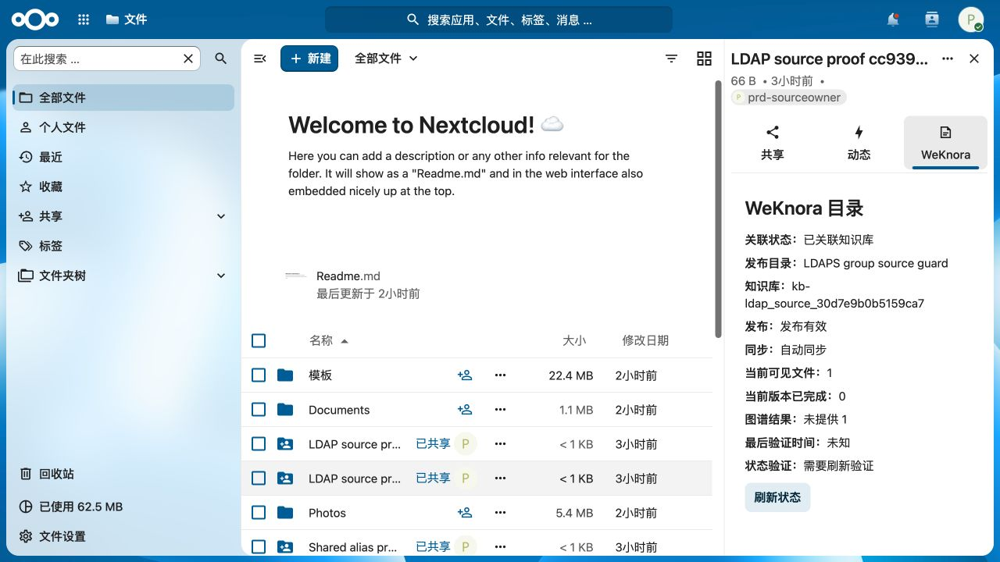
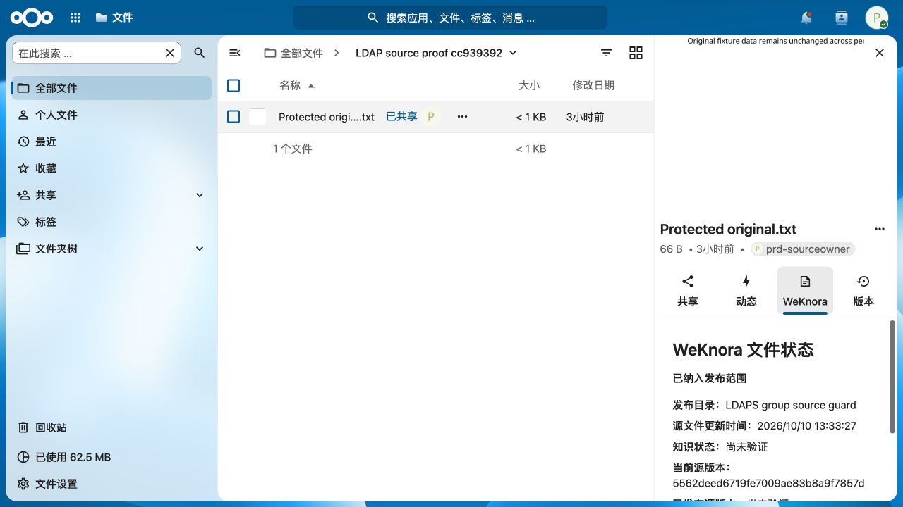
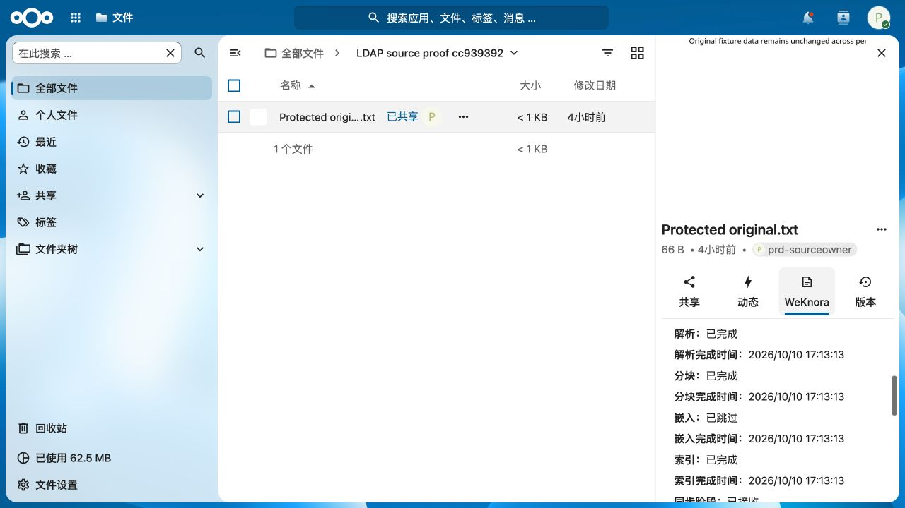
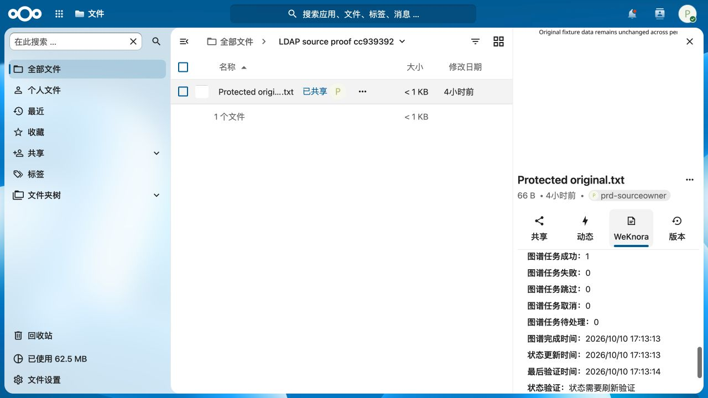
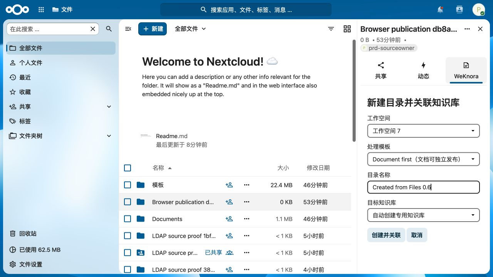
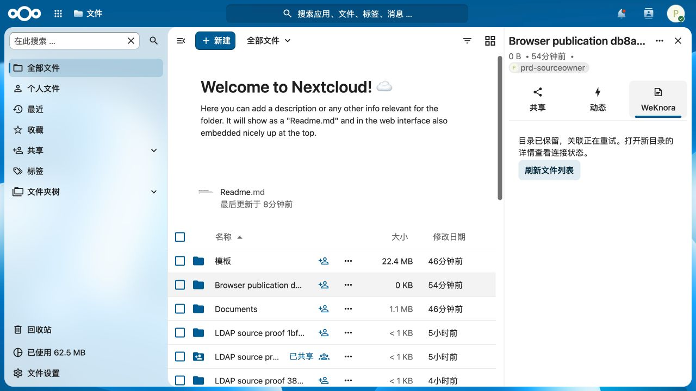
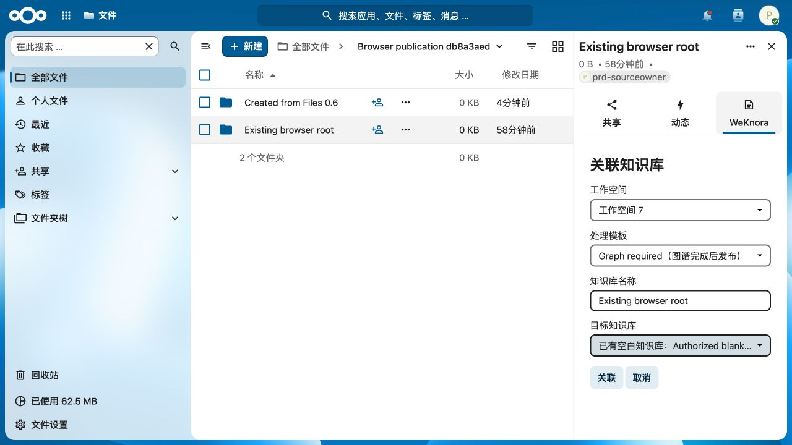
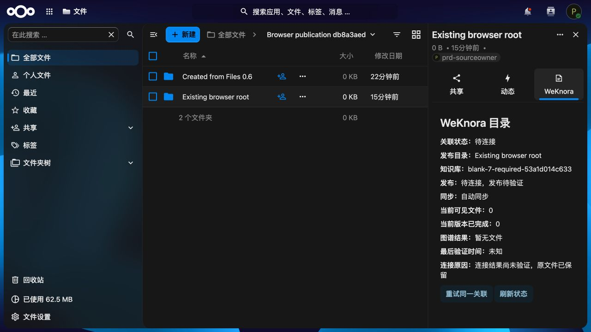
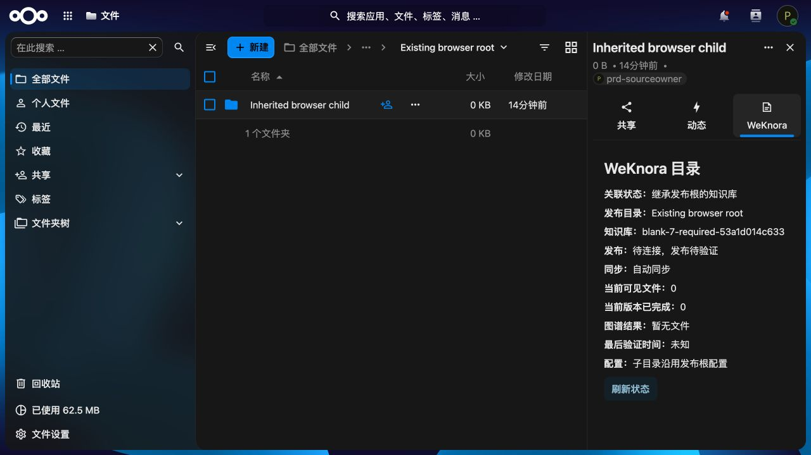

# Nextcloud 34 Files 浏览器验证记录

最终浏览器验证使用本任务的 `nextcloud-auto-space-prd-test-20261010`、Nextcloud 34.0.4 和正常升级后的 integration_weknora 0.6.0。下文保留先前 0.5.0 的只读观测，明确区分后续创建、关联和 pending 状态复验；初始观测期间因 100 GB 测试仍在运行而没有升级应用。

Chrome 的电脑控制入口不可用，本机处于锁定状态；实际网页验证使用 Codex IAB 的浏览器渲染器及 CUA。不是模拟 DOM 或静态 HTML。临时 Python HTTP 反向代理独立于 Nextcloud 容器，只发布到宿主 `127.0.0.1`，标签为 `codex.task=auto-space-prd-20261010`，上限 0.5 CPU / 128 MiB。代理只指向本任务网络内的 Nextcloud，保持 Nextcloud 的 trusted Host。所有账号和原件均为本次 synthetic fixtures。

实际操作与观测：

- 登录 `auto-prd-admin`，打开 Files 34 的真实目录详情，WeKnora tab 实际注册并可选中。真实目录状态 GET 返回并呈现，发布规则容器内的“新建关联目录”入口可点击；旧 fixture 候选服务配置不完整，候选 GET 失败后显示可理解的失败信息。此观测不能证明创建提交已经通过。
- 登录真实 LDAPS 账号 `prd-alice`，通过 NC 当前 PrdSourceRead 分组共享读取 `LDAP source proof cc939392`。Files 自身明确显示没有上传/创建权限。WeKnora 根面板呈现专用 KB、有效发布、自动同步、当前可见文件 1、当前完成 0，只有刷新状态按钮，没有关联、迁移、同步开关。
- 打开同一共享根的 `Protected original.txt` 真实文件详情。WeKnora tab 正常出现，真实文件 API 展示源 ETag、源更新时间和“尚未验证”，不显示已经完成或提问链接。此 fixture 未提供当前可验证的 v2 阶段完成证明，未将其当作完整 v2 图谱界面验收。
- 发现手动配对的根没有自动关联 intent 时，旧 UI 错显示“未关联”；已修成以已确认的 KB 元数据呈现“已关联知识库”。发现零值图谱计数挤满侧栏，已只显示正数计数。新临时 loopback origin 避免旧 0.5.0 资源缓存，已实际验证更新后的两个显示结果。

本轮初始代理未转发 REPORT，导致 Files 收藏列表出现 HTTP 501；已补全 REPORT/OPTIONS 等方法并重启精确 owned 代理。浏览器还记录 Nextcloud core user-status 与 text editor 生命周期告警，不能归因于 WeKnora。部分 CUA Playwright locator 在自定义元素页面出现内部 `Maximum call stack size exceeded`；改用实际 AX 对象操作与截图后仍能验证页面，不修改业务 DOM。

初始只读截图未被当作完整创建提交验收。100 GB 源测试结束后，正常 OCC 升级 integration_weknora 到 0.6.0，维护模式关闭、0023–0028 迁移已存在；随后重新加载实际 Files 页面完成以下独立 fixture 验证。

随后实际 WeKnora extraction provider / graph worker / signed NC inbox 组件测试向同一 Protected original.txt 写入完整 v2 状态。Alice 页面实际显示解析/分块/索引完成、嵌入跳过、同步已接收、发布已发布、required 图谱，以及六项图谱计数（预期 1 / 成功 1 / 失败 0 / 跳过 0 / 取消 0 / 待处理 0），完成与验证时间为 17:13。截图时已超出 300 秒验证有效期，所以当前知识状态正确显示尚未验证、图谱待验证和需要刷新，没有提问链接；这些截图只能证明真实阶段与最后验证事实展示，不能称为截图当时当前版本就绪。

0.6.0 下发布管理者 `prd-sourceowner` 使用真实 LDAPS 登录，identity DEV 放行始终为 0。新且独占的 `Browser publication db8a3aed` 规则容器只允许当前账号、tenant 7 的 optional / required 两个精确模板。受控 HTTP backend 的边界是候选/预留及故意未知 pair ACK，不包含真实模型执行或最终配对成功。为该 fixture 的精确 Folder 路由临时配置 Apache `THE_REQUEST` 范围内的 development HTTP 与精确 mock origin；结束后已经恢复原 `.htaccess`，没有留下该例外。

- 在真实 Files 目录侧栏点击“新建关联目录”，同一工作空间有独立 optional/required 模板选择。选择 optional 和自动创建，输入 `Created from Files 0.6` 并实际提交。页面确认目录已保留、关联正在重试；实际 PG intent `3d88f1f7-6e02-46cd-b0f9-8c8798fa6c1d` 为 pending，实际 root ID 22820 保留，选择 template-7。
- 选择既有 `Existing browser root`（22744），点击关联，选择 required 模板及 `blank-7-required-53a1d014c633` 空白知识库并实际提交。页面显示待连接与原件保留，实际 intent `7774f626-041e-490a-9058-422b88f636c8` pending，immutable request 为 tenant 7 / template-7-required / 选定 KB，没有切换成自动创建。
- 在同一根内创建小空目录 `Inherited browser child`（22821），实际侧栏显示继承相同 KB、子目录沿用根配置，仅有刷新按钮，没有关联、同步、迁移或新建关联入口。
- 真实浏览器发现 direct_children 规则的直接子目录被错误允许再创建独立孙目录根。已由 core 维护者修正；真实 LDAP runtime 回归确认只允许规则容器创建、未绑定直接子目录不能创建孙目录根，失败前不写出目录。源码与测试 PHP 语法均通过。

[真实 PG intent 与继承结果 receipt](evidence/nextcloud-browser-20261010/submit-receipt.json) 不含凭据；所有截图均为实际浏览器渲染，未替换业务 DOM。

复核旧截图发现，pending/未知配对 ACK 被旧 UI 根据源 binding 的 active 标记误显示“发布有效”。已修正：只有源 active、pairing active、且现存关联 intent active 时显示有效；手工 active pair 无 intent 仍兼容。相同实际根与子目录重新加载后的截图现在明确显示“待连接，发布待验证”，保留继承信息。旧截图文件作为修复前记录保留，不代表最终展示。后端发布标记、授权与配对协议未改变。
